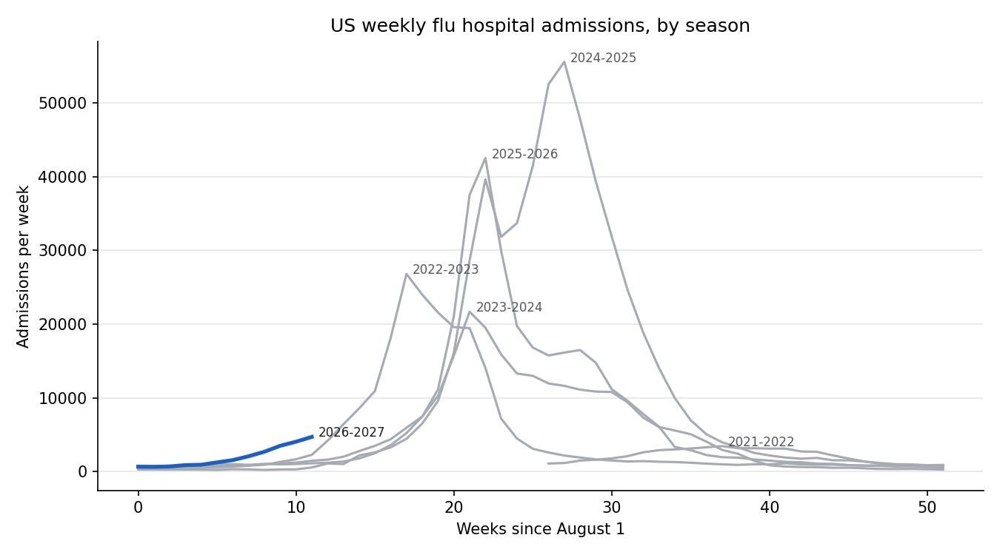
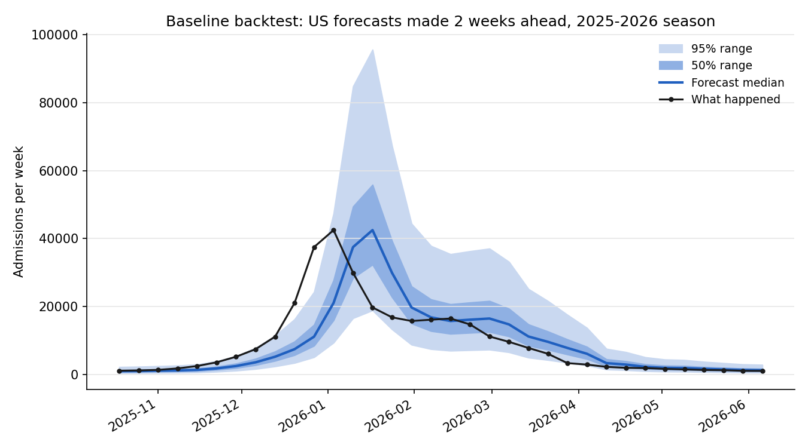

# Flu Forecasting with an SIRS Model — CDC FluSight 2026–27

Real-time forecasts of weekly influenza hospital admissions for all 50 US states, DC, Puerto Rico and the nation, submitted every week to the CDC's **FluSight 2026–27** forecasting challenge. The project builds from a simple baseline to a mechanistic **SIRS differential-equation model**, and ends with a paper comparing the two approaches on a full season of live, prospective forecasts.

**Author:** Bernard Frimpong — M.S. Applied Mathematics, University of Akron
**FluSight team / model:** `BFrimpong-baseline` (Stage 1)
**Season:** October 7, 2026 – May 26, 2027 · forecasts due every Wednesday, 11 PM Eastern

---

## Research question

> Across a full flu season of real-time forecasts, does a mechanistic SIRS model forecast state-level hospital admissions better than statistical models — and in which phase of the epidemic (growth, peak, decline)?

Every forecast is pushed to the CDC's public repository before the true numbers exist, so the evaluation cannot be tuned after the fact.

## Project stages

| Stage | Model | Status |
| --- | --- | --- |
| 1 | Flat baseline on the log scale; data pipeline; validator; backtest | **Done** |
| 2 | Statistical growth model (regression on recent log-admissions) | Next |
| 3 | SIRS model with a time-varying transmission rate, fitted per state | Planned |
| 4 | Uncertainty from an ensemble / particle filter | Planned |
| 5 | Hybrid: SIRS plus a small machine-learning error correction | Stretch |
| 6 | Season evaluation and paper (medRxiv, then journal) | June 2027 |

Stage guides: [STAGE1_GUIDE.md](STAGE1_GUIDE.md)

## Stage 1 results

**The season has started early.** National admissions tripled in five weeks, from 1,247 (week ending Sep 5) to 3,835 (week ending Oct 10). California and Florida are already near 500 admissions a week, roughly three to five times their level at the same point last season.



**Baseline backtest on the 2025–26 season** (34 weekly forecasts per location; WIS = weighted interval score, lower is better):

| Level | Weeks after last data | Mean WIS | 50% range coverage | 95% range coverage |
| --- | --- | --- | --- | --- |
| States (average) | 1 (horizon 0) | 36.3 | 0.53 | 0.96 |
| States (average) | 4 (horizon 3) | 114.0 | 0.40 | 0.89 |
| US national | 1 (horizon 0) | 1,601.8 | 0.56 | 0.91 |
| US national | 4 (horizon 3) | 5,450.1 | 0.29 | 0.74 |

The ranges are honest one week out but too narrow further ahead, and the flat median always lags behind a rising or falling epidemic:



That lag is the gap a model with epidemic dynamics (growth and depletion of susceptible people) should close, which is exactly what Stages 2–3 test.

*Caveat:* the backtest uses today's revised data. Live forecasts see early, incomplete numbers, so live scores will be slightly worse. Dated snapshots of every download are kept in `data/raw/` for a fair evaluation later.

## How the baseline works

1. Median = the latest observed weekly admissions ("next week looks like this week").
2. Take week-to-week changes in log(admissions + 1) over the past three years, in-season weeks only (October–May), and include each change with its sign flipped.
3. For a target *k* weeks after the last data point, multiply those change quantiles by √*k* (random-walk scaling: variance adds up week by week).
4. Convert back from the log scale, round to whole admissions, never below zero.

## Repository layout

```
flu-forecasting-sirs/
├── README.md
├── STAGE1_GUIDE.md                 step-by-step guide for Stage 1 and weekly submission
├── requirements.txt                pinned package versions
├── scripts/
│   ├── common.py                   shared settings: names, quantile levels, paths
│   ├── baseline_model.py           the Stage 1 model
│   ├── 01_download_data.py         download latest data + dated snapshot
│   ├── 02_explore_data.py          season plots and peaks
│   ├── 03_baseline_forecast.py     make the weekly submission file
│   ├── 04_validate_submission.py   check the file against FluSight rules
│   └── 05_backtest_baseline.py     score the model on last season
├── model-metadata/
│   └── BFrimpong-baseline.yml      model description required by the hub
├── model-output/
│   └── BFrimpong-baseline/         one forecast file per week
├── data/                           latest data + data/raw/ dated snapshots
└── results/                        plots and score tables
```

## How to run

Windows, Python 3.13, from the project folder:

```
py -3.13 -m venv .venv
.venv\Scripts\activate
pip install -r requirements.txt
python scripts/01_download_data.py
python scripts/02_explore_data.py
python scripts/03_baseline_forecast.py
python scripts/04_validate_submission.py
python scripts/05_backtest_baseline.py
```

Weekly routine (Wednesday afternoon, after the CDC data update): run scripts 01, 03 and 04, then submit (see [STAGE1_GUIDE.md](STAGE1_GUIDE.md), Part 4).

## Data

- **Target:** NHSN Weekly Hospital Respiratory Dataset, laboratory-confirmed influenza admissions, as published in the FluSight hub's `target-data/` folder.
- **Locations and populations:** FluSight hub `auxiliary-data/locations.csv`.
- All data are public, aggregated counts; no individual-level data are used.

## Links

- CDC FluSight 2026–27 hub: https://github.com/cdcepi/FluSight-forecast-hub
- CDC weekly flu forecasts: https://www.cdc.gov/flu-forecasting/

## AI assistance

Code and documentation were drafted with help from Claude (Anthropic). All modelling choices were reviewed by the author, and every script was run and checked by the author. A full disclosure will accompany the paper, which will be posted as a preprint at the end of the season.

## License

Code: MIT. Forecast files: CC-BY-4.0 (as declared in the model metadata).
