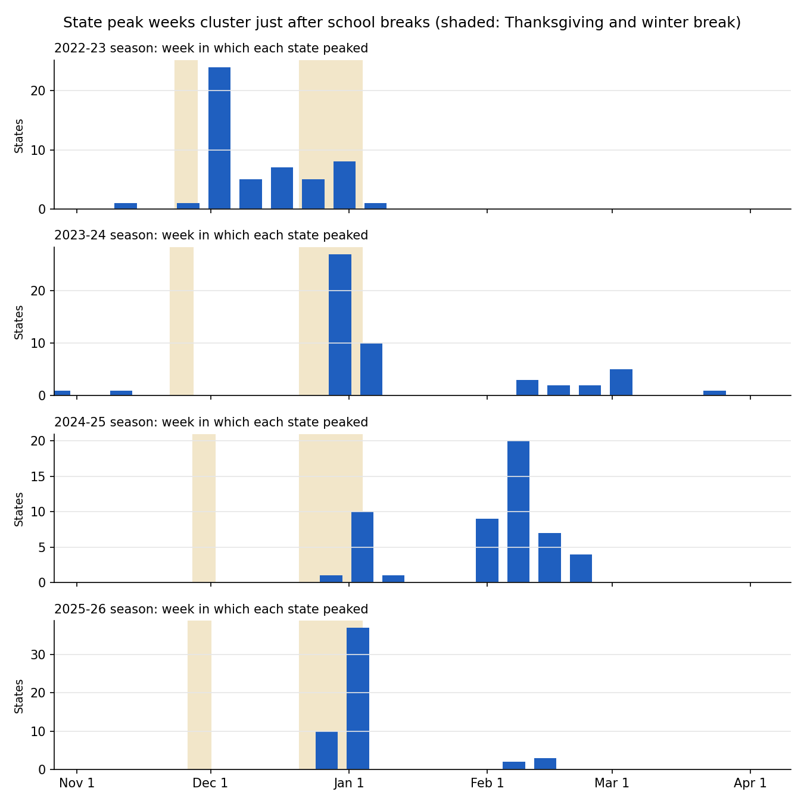
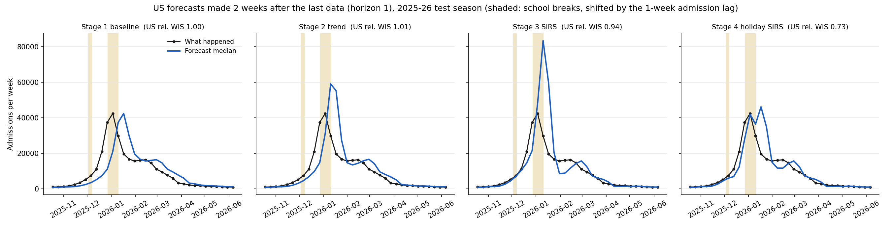
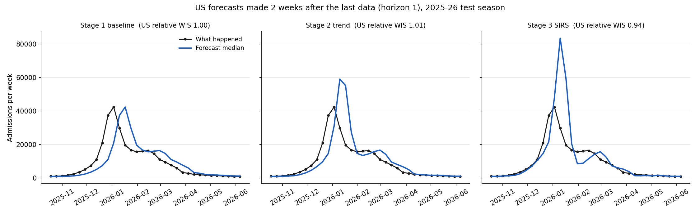
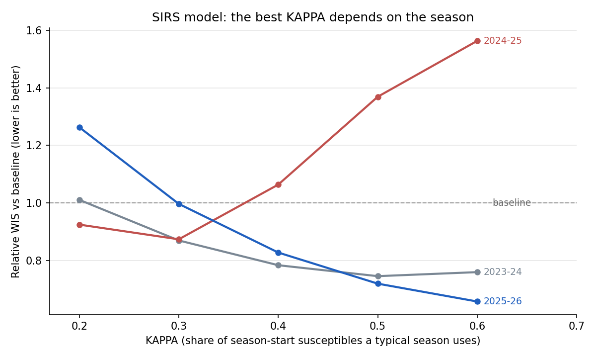

# Flu Forecasting with an SIRS Model — CDC FluSight 2026–27

Real-time forecasts of weekly influenza hospital admissions for all 50 US states, DC, Puerto Rico and the nation, submitted every week to the CDC's **FluSight 2026–27** forecasting challenge. The project builds from a simple baseline to a mechanistic **SIRS differential-equation model**, and ends with a paper comparing the approaches on a full season of live, prospective forecasts.

**Author:** Bernard Frimpong — M.S. Applied Mathematics, University of Akron
**FluSight team / models:** `BFrimpong-baseline` (Stage 1, since Oct 24, 2026) · `BFrimpong-trend` (Stage 2, from Oct 31, 2026) · `BFrimpong-sirs` (Stage 3) and `BFrimpong-sirs_hol` (Stage 4), both from Nov 7, 2026
**Season:** October 7, 2026 – May 26, 2027 · forecasts due every Wednesday, 11 PM Eastern

---

## Research question

> Across a full flu season of real-time forecasts, does a mechanistic SIRS model forecast state-level hospital admissions better than statistical models — and in which phase of the epidemic (growth, peak, decline)?

Every forecast is pushed to the CDC's public repository before the true numbers exist, so the evaluation cannot be tuned after the fact.

## Project stages

| Stage | Model | Status |
| --- | --- | --- |
| 1 | Flat baseline on the log scale; data pipeline; validator; backtest | **Done** — first submission Oct 24, 2026 |
| 2 | Damped growth model (recent log-linear trend, damped) | **Done** — live from Oct 31, 2026 |
| 3 | SIRS model (RK4) with weekly R_t and susceptible depletion | **Done** — live from Nov 7, 2026 |
| 4 | SIRS with school-holiday transmission and a 1-week admission lag | **Done** — live from Nov 7, 2026 (designated for the CDC ensemble) |
| 4b | Uncertainty: ensemble / particle filter; post-holiday rebound | Next |
| 5 | Hybrid: SIRS plus a small machine-learning error correction | Stretch |
| 6 | Season evaluation and paper (medRxiv, then journal) | June 2027 |

Stage guides: [STAGE1_GUIDE.md](STAGE1_GUIDE.md) · [STAGE2_GUIDE.md](STAGE2_GUIDE.md) · [STAGE3_GUIDE.md](STAGE3_GUIDE.md) · [STAGE4_GUIDE.md](STAGE4_GUIDE.md)

## Stage 4 results: school holidays drive the turning points

**The discovery.** Stage 3 assumed growth slows gradually as susceptibles run out. The data say otherwise: weekly growth kept *accelerating* right up to each national peak, then collapsed within one or two weeks, and the turns line up with school breaks.

| Season | Week with the most state peaks | States peaking that week | Follows |
| --- | --- | --- | --- |
| 2022–23 | Dec 3 | 24 of 52 | Thanksgiving break |
| 2023–24 | Dec 30 | 27 of 52 | Winter break |
| 2024–25 | Feb 8 (after a dip on Jan 4) | 20 of 52 | Winter-break dip, then rebound once schools reopened |
| 2025–26 | Jan 3 | 37 of 52 | Winter break |



**The model.** The Stage 3 SIRS model with two additions: transmission is multiplied by a holiday factor on school-break days (Wednesday–Sunday of Thanksgiving week; Dec 21–Jan 3), and hospital admissions lag infections by 7 days. Two tuned settings, κ and the holiday factor, chosen together with the same fair-test rule.

**Fair test.** The pair κ = 0.3, holiday factor 0.8 (20% less transmission during breaks) was best on the tuning seasons and also best over all three seasons:

| Holiday factor (κ = 0.3) | 2023–24 | 2024–25 | 2025–26 (test) |
| --- | --- | --- | --- |
| 0.6 | 1.452 | 0.940 | 1.108 |
| 0.7 | 1.020 | 0.797 | 0.881 |
| **0.8** | **0.783** | **0.747** | **0.812** |
| 1.0 (= Stage 3) | 0.870 | 0.874 | 0.997 |

Within every κ tried (0.3, 0.4, 0.5) and every season, 0.8 was the best holiday factor on the grid; 0.9 was not tested.

**Test season 2025–26, all models** (relative WIS vs baseline, lower is better):

| | Stage 2 trend | Stage 3 SIRS | **Stage 4 holiday SIRS** |
| --- | --- | --- | --- |
| Overall | 1.032 | 0.997 | **0.812** |
| Growth | 0.831 | 0.788 | **0.742** |
| **Peak (± 2 weeks)** | 1.009 | 1.049 | **0.672** |
| Decline | 1.110 | 0.987 | 0.997 |
| Bias at the peak (admissions) | −130 | +320 | **−41** |



**What this shows.** Letting transmission drop during school breaks fixes the turning point that every earlier model missed: the peak phase goes from the worst phase (Stage 3: 5% worse than the baseline) to the best (33% better), and the peak overshoot almost disappears. The remaining weakness is the decline: the model predicts a rebound when schools reopen. That rebound happened in 2024–25 but not in 2025–26, so the next step is to learn how much rebound to expect.

**Live use.** `BFrimpong-sirs_hol` is submitted from Nov 7, 2026, and designated for the CDC ensemble. Thanksgiving 2026 (Nov 26) and the winter break are a genuine prospective test of the holiday effect.

## Stage 3 results: the SIRS model

**The model.** An SIRS model (γ = 1/3 per day, ω = 1/365 per day) is solved forward four weeks with RK4 for every location, every week. Its reproduction number R_t = 1 + (r/7)/γ comes from the recent growth rate r, and its susceptible fraction falls as this season's admissions accumulate:

s_now = 1 − κ × (admissions so far this season) ÷ (typical past season total).

κ, the share of the season-start susceptibles a typical season uses, is the only tuned parameter. Growth slows because susceptibles run out, not because a damping factor says so.

**Fair test** (same rule as Stage 2: κ chosen on 2023–24 + 2024–25, scored once on 2025–26):

| κ | 2023–24 | 2024–25 | 2025–26 | Tuning mean | All-three mean |
| --- | --- | --- | --- | --- | --- |
| 0.2 | 1.011 | 0.925 | 1.263 | 0.968 | 1.066 |
| **0.3** | 0.870 | 0.874 | **0.997** | **0.872** | 0.914 |
| 0.4 | 0.784 | 1.064 | 0.828 | 0.924 | **0.892** |
| 0.5 | 0.746 | 1.369 | 0.720 | 1.058 | 0.945 |
| 0.6 | 0.760 | 1.563 | 0.658 | 1.162 | 0.994 |

The rule picks κ = 0.3, which ties the baseline on the test season (0.997) and is 3.4% better than the Stage 2 trend model (relative WIS 0.966). Live forecasts use κ = 0.4, the best over all three seasons.

| Test season 2025–26, by phase | Trend vs baseline | SIRS vs baseline | Bias: baseline → trend → SIRS (admissions) |
| --- | --- | --- | --- |
| Growth | 0.831 | **0.788** | −79 → −61 → **−8** |
| Peak (± 2 weeks) | 1.009 | 1.049 | −416 → −130 → +320 |
| Decline | 1.110 | 0.987 | +138 → +137 → +56 |



**What this shows.**
- **Growth:** the mechanism removes almost all of the lag; the average bias falls from −79 to −8 admissions.
- **Decline:** once R_t is below 1, the SIRS model decays smoothly instead of chasing noise, closing the trend model's 11% deficit.
- **Peak:** the turn comes only when enough susceptibles are used up, so the model is only as good as its estimate of the pool. The best κ differs strongly by season:



The reason is season size. The model assumes this season will be about as big as a typical past season:

| Season | US total admissions | "Typical" assumed | Actual ÷ typical |
| --- | --- | --- | --- |
| 2023–24 | 254,490 | 229,663 | 1.11 |
| 2024–25 | 558,926 | 242,077 | **2.31** |
| 2025–26 | 335,989 | 347,693 | 0.97 |

In the normal-sized seasons a larger κ (0.5–0.6) is 24–34% better than the baseline. In 2024–25, a season more than twice the usual size, a large κ predicts the turn far too early. A fixed κ cannot serve both. **Stage 4** will therefore learn the size of the susceptible pool from the current season's data as it unfolds.

## Stage 2 results: trend vs baseline

**Fair test:** the trend model's settings were chosen on the 2023–24 and 2024–25 seasons only, then scored once on 2025–26. Relative WIS = WIS(trend) ÷ WIS(baseline) on the same forecasts; below 1 means the trend model is better.

| Season | Role | Relative WIS |
| --- | --- | --- |
| 2023–24 | tuning | 0.935 |
| 2024–25 | tuning | 0.930 |
| **2025–26** | **test (never used for tuning)** | **1.032** |

On the test season, by epidemic phase (each location's own peak; "peak" = within 2 weeks of it):

| Phase | Forecasts | Relative WIS | Average error of the median, baseline → trend |
| --- | --- | --- | --- |
| Growth | 1,874 | **0.83** (17% better) | −79 → −61 admissions |
| Peak (± 2 weeks) | 1,060 | 1.01 | −416 → −130 admissions |
| Decline | 4,274 | 1.11 (11% worse) | +138 → +137 admissions |

**What this shows.** Following the recent growth rate removes much of the baseline's lag while the epidemic grows. But the trend cannot see the turn coming: it keeps growing past the peak (the US forecast reached about 59,000 against a true peak of 42,500) and adds noise during the long decline. Momentum fixes the lag; only a mechanism that ends growth — depletion of susceptible people — can anticipate the turn. That is the job of the Stage 3 SIRS model.


**Live settings.** For the 2026–27 forecasts, the same selection rule was applied to all three past seasons, giving a 3-week window and damping 0.4 (slightly more cautious than the 0.5 used in the test).

**Tried and dropped:** building the forecast range from the model's own past errors (instead of the baseline's √k rule). It gave better coverage but no better WIS, so both models share the baseline's spread and differ only in their median.

## Stage 1 results: the baseline

**The season started early.** National admissions rose from 1,247 (week ending Sep 5) to 4,698 (week ending Oct 17, first report), with growth not yet slowing.


**Baseline backtest on 2025–26** (WIS = weighted interval score, lower is better):

| Level | Weeks after last data | Mean WIS | 50% range coverage | 95% range coverage |
| --- | --- | --- | --- | --- |
| States (average) | 1 (horizon 0) | 36.3 | 0.53 | 0.96 |
| States (average) | 4 (horizon 3) | 114.0 | 0.40 | 0.89 |
| US national | 1 (horizon 0) | 1,601.8 | 0.56 | 0.91 |
| US national | 4 (horizon 3) | 5,450.1 | 0.29 | 0.74 |

The ranges are honest one week out but too narrow further ahead, because weekly changes during an epidemic keep their direction instead of behaving like independent coin flips. The flat median is the observed curve shifted two weeks to the right:


**Reporting revisions.** Recent weeks are revised upward as late hospital reports arrive: between Oct 20 and Oct 21, 2026 the week ending Oct 10 rose from 3,835 to 4,044 (+5.4%), while weeks three or more weeks old changed by 1% or less. Dated snapshots of every download are kept in `data/raw/` so forecasts can later be judged against the data available on the day they were made.

## How the models work

**Stage 1 — baseline**
1. Median = the latest observed weekly admissions.
2. Spread = in-season (October–May) week-to-week changes in log(admissions + 1) over the past three years, each included with its sign flipped.
3. For a target *k* weeks after the last data point, the spread is multiplied by √*k*.
4. Back-transform, round to whole admissions, never below zero.

**Stage 2 — damped trend**
1. Growth rate *r* = least-squares slope of log(admissions + 1) over the last 3 weeks.
2. Median *k* weeks ahead = last value × exp(*r* × (φ + φ² + … + φᵏ)), with damping φ = 0.4, so each extra week keeps only 40% of the previous week's growth.
3. Same spread as the baseline, centred on the new median.

**Stage 4 — holiday SIRS**
1. As Stage 3, with κ = 0.3.
2. Transmission × 0.8 on school-break days (Thanksgiving Wed–Sun; Dec 21–Jan 3).
3. Admissions lag infections by 7 days; the measured R_t is divided by the average holiday factor behind it to give term-time transmission.
4. Same spread as the baseline, centred on the median.

**Stage 3 — SIRS**
1. R_t = 1 + (*r* ÷ 7) ÷ γ from the same growth rate; γ = 1/3 per day.
2. Susceptibles left s_now = 1 − κ × (season so far ÷ typical season), κ = 0.4.
3. β = γ R_t ÷ s_now; the infectious fraction reproduces this week's admissions.
4. Solve the SIRS equations 4 weeks ahead with RK4 (step 0.5 day); weekly new infections give the median.
5. Same spread as the baseline, centred on the SIRS median.

## Repository layout

```
flu-forecasting-sirs/
├── README.md
├── STAGE1_GUIDE.md                 Stage 1 guide and how to submit
├── STAGE2_GUIDE.md                 Stage 2 guide and the two-model weekly routine
├── STAGE3_GUIDE.md                 Stage 3 guide
├── STAGE4_GUIDE.md                 Stage 4 guide and the four-model weekly routine
├── requirements.txt                pinned package versions
├── scripts/
│   ├── common.py                   shared settings: names, quantile levels, paths
│   ├── baseline_model.py           Stage 1 model
│   ├── trend_model.py              Stage 2 model
│   ├── sirs_model.py               Stage 3 model (SIRS equations, RK4)
│   ├── holiday_sirs_model.py       Stage 4 model (SIRS + school holidays + admission lag)
│   ├── scoring.py                  WIS, coverage and backtest helpers
│   ├── 01_download_data.py         download latest data + dated snapshot
│   ├── 02_explore_data.py          season plots and peaks
│   ├── 03_baseline_forecast.py     weekly baseline submission file
│   ├── 04_validate_submission.py   check every model's newest file against FluSight rules
│   ├── 05_backtest_baseline.py     score the baseline on last season
│   ├── 06_trend_forecast.py        weekly trend submission file
│   ├── 07_backtest_compare.py      tune and test the trend model against the baseline
│   ├── 08_sirs_forecast.py         weekly SIRS submission file
│   ├── 09_backtest_sirs.py         tune and test SIRS against baseline and trend
│   ├── 10_holiday_forecast.py      weekly holiday-SIRS submission file
│   └── 11_backtest_holiday.py      tune and test holiday SIRS against Stages 1-3
├── model-metadata/
│   ├── BFrimpong-baseline.yml
│   ├── BFrimpong-trend.yml
│   ├── BFrimpong-sirs.yml
│   └── BFrimpong-sirs_hol.yml
├── model-output/
│   ├── BFrimpong-baseline/         one forecast file per week
│   ├── BFrimpong-trend/
│   ├── BFrimpong-sirs/
│   └── BFrimpong-sirs_hol/
├── data/                           latest data + data/raw/ dated snapshots
└── results/                        plots and score tables
```

## How to run

Windows, Python 3.13, from the project folder:

```
.venv\Scripts\activate
pip install -r requirements.txt
python scripts/01_download_data.py
python scripts/02_explore_data.py
python scripts/03_baseline_forecast.py
python scripts/06_trend_forecast.py
python scripts/08_sirs_forecast.py
python scripts/10_holiday_forecast.py
python scripts/04_validate_submission.py
python scripts/05_backtest_baseline.py
python scripts/07_backtest_compare.py
python scripts/07_backtest_compare.py --tune
python scripts/09_backtest_sirs.py
python scripts/09_backtest_sirs.py --tune
python scripts/11_backtest_holiday.py
python scripts/11_backtest_holiday.py --tune
```

The three `--tune` commands redo the tuning grids and take about 5, 10 and 25 minutes.

**Weekly routine** (Wednesday afternoon, after the CDC data update): scripts 01, 03, 06, 08, 10 and 04, then submit the files (see [STAGE4_GUIDE.md](STAGE4_GUIDE.md), Part 3).

## Data

- **School holidays:** a fixed typical US K-12 calendar (Thanksgiving Wed–Sun; Dec 21–Jan 3).
- **Target:** NHSN Weekly Hospital Respiratory Dataset, laboratory-confirmed influenza admissions, as published in the FluSight hub's `target-data/` folder.
- **Locations and populations:** FluSight hub `auxiliary-data/locations.csv`.
- All data are public, aggregated counts; no individual-level data are used.

## Links

- CDC FluSight 2026–27 hub: https://github.com/cdcepi/FluSight-forecast-hub
- CDC weekly flu forecasts: https://www.cdc.gov/flu-forecasting/

## AI assistance

Code and documentation were drafted with help from Claude (Anthropic). All modelling choices were reviewed by the author, and every script was run and checked by the author. A full disclosure will accompany the paper, which will be posted as a preprint at the end of the season.

## License

Code: MIT. Forecast files: CC-BY-4.0 (as declared in the model metadata).
