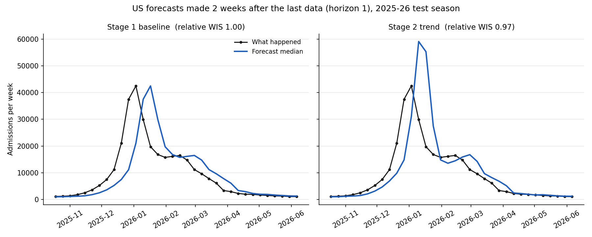

# Flu Forecasting with an SIRS Model — CDC FluSight 2026–27

Real-time forecasts of weekly influenza hospital admissions for all 50 US states, DC, Puerto Rico and the nation, submitted every week to the CDC's **FluSight 2026–27** forecasting challenge. The project builds from a simple baseline to a mechanistic **SIRS differential-equation model**, and ends with a paper comparing the approaches on a full season of live, prospective forecasts.

**Author:** Bernard Frimpong — M.S. Applied Mathematics, University of Akron
**FluSight team / models:** `BFrimpong-baseline` (Stage 1, since Oct 24, 2026) · `BFrimpong-trend` (Stage 2, from Oct 31, 2026)
**Season:** October 7, 2026 – May 26, 2027 · forecasts due every Wednesday, 11 PM Eastern

---

## Research question

> Across a full flu season of real-time forecasts, does a mechanistic SIRS model forecast state-level hospital admissions better than statistical models — and in which phase of the epidemic (growth, peak, decline)?

Every forecast is pushed to the CDC's public repository before the true numbers exist, so the evaluation cannot be tuned after the fact.

## Project stages

| Stage | Model | Status |
| --- | --- | --- |
| 1 | Flat baseline on the log scale; data pipeline; validator; backtest | **Done** — first submission Oct 24, 2026 |
| 2 | Damped growth model (recent log-linear trend, damped) | **Done** — live from Oct 31, 2026 |
| 3 | SIRS model with a time-varying transmission rate, fitted per state | Next |
| 4 | Uncertainty from an ensemble / particle filter | Planned |
| 5 | Hybrid: SIRS plus a small machine-learning error correction | Stretch |
| 6 | Season evaluation and paper (medRxiv, then journal) | June 2027 |

Stage guides: [STAGE1_GUIDE.md](STAGE1_GUIDE.md) · [STAGE2_GUIDE.md](STAGE2_GUIDE.md)

## Stage 2 results: trend vs baseline

**Fair test:** the trend model's settings were chosen on the 2023–24 and 2024–25 seasons only, then scored once on 2025–26. Relative WIS = WIS(trend) ÷ WIS(baseline) on the same forecasts; below 1 means the trend model is better.

| Season | Role | Relative WIS |
| --- | --- | --- |
| 2023–24 | tuning | 0.935 |
| 2024–25 | tuning | 0.930 |
| **2025–26** | **test (never used for tuning)** | **1.032** |

On the test season, by epidemic phase (each location's own peak; "peak" = within 2 weeks of it):

| Phase | Forecasts | Relative WIS | Average error of the median, baseline → trend |
| --- | --- | --- | --- |
| Growth | 1,874 | **0.83** (17% better) | −79 → −61 admissions |
| Peak (± 2 weeks) | 1,060 | 1.01 | −416 → −130 admissions |
| Decline | 4,274 | 1.11 (11% worse) | +138 → +137 admissions |

**What this shows.** Following the recent growth rate removes much of the baseline's lag while the epidemic grows. But the trend cannot see the turn coming: it keeps growing past the peak (the US forecast reached about 59,000 against a true peak of 42,500) and adds noise during the long decline. Momentum fixes the lag; only a mechanism that ends growth — depletion of susceptible people — can anticipate the turn. That is the job of the Stage 3 SIRS model.



**Live settings.** For the 2026–27 forecasts, the same selection rule was applied to all three past seasons, giving a 3-week window and damping 0.4 (slightly more cautious than the 0.5 used in the test).

**Tried and dropped:** building the forecast range from the model's own past errors (instead of the baseline's √k rule). It gave better coverage but no better WIS, so both models share the baseline's spread and differ only in their median.

## Stage 1 results: the baseline

**The season started early.** National admissions rose from 1,247 (week ending Sep 5) to 4,698 (week ending Oct 17, first report), with growth not yet slowing.


**Baseline backtest on 2025–26** (WIS = weighted interval score, lower is better):

| Level | Weeks after last data | Mean WIS | 50% range coverage | 95% range coverage |
| --- | --- | --- | --- | --- |
| States (average) | 1 (horizon 0) | 36.3 | 0.53 | 0.96 |
| States (average) | 4 (horizon 3) | 114.0 | 0.40 | 0.89 |
| US national | 1 (horizon 0) | 1,601.8 | 0.56 | 0.91 |
| US national | 4 (horizon 3) | 5,450.1 | 0.29 | 0.74 |

The ranges are honest one week out but too narrow further ahead, because weekly changes during an epidemic keep their direction instead of behaving like independent coin flips. The flat median is the observed curve shifted two weeks to the right:


**Reporting revisions.** Recent weeks are revised upward as late hospital reports arrive: between Oct 20 and Oct 21, 2026 the week ending Oct 10 rose from 3,835 to 4,044 (+5.4%), while weeks three or more weeks old changed by 1% or less. Dated snapshots of every download are kept in `data/raw/` so forecasts can later be judged against the data available on the day they were made.

## How the models work

**Stage 1 — baseline**
1. Median = the latest observed weekly admissions.
2. Spread = in-season (October–May) week-to-week changes in log(admissions + 1) over the past three years, each included with its sign flipped.
3. For a target *k* weeks after the last data point, the spread is multiplied by √*k*.
4. Back-transform, round to whole admissions, never below zero.

**Stage 2 — damped trend**
1. Growth rate *r* = least-squares slope of log(admissions + 1) over the last 3 weeks.
2. Median *k* weeks ahead = last value × exp(*r* × (φ + φ² + … + φᵏ)), with damping φ = 0.4, so each extra week keeps only 40% of the previous week's growth.
3. Same spread as the baseline, centred on the new median.

## Repository layout

```
flu-forecasting-sirs/
├── README.md
├── STAGE1_GUIDE.md                 Stage 1 guide and how to submit
├── STAGE2_GUIDE.md                 Stage 2 guide and the new weekly routine
├── requirements.txt                pinned package versions
├── scripts/
│   ├── common.py                   shared settings: names, quantile levels, paths
│   ├── baseline_model.py           Stage 1 model
│   ├── trend_model.py              Stage 2 model
│   ├── scoring.py                  WIS and coverage, shared by all comparisons
│   ├── 01_download_data.py         download latest data + dated snapshot
│   ├── 02_explore_data.py          season plots and peaks
│   ├── 03_baseline_forecast.py     weekly baseline submission file
│   ├── 04_validate_submission.py   check every model's newest file against FluSight rules
│   ├── 05_backtest_baseline.py     score the baseline on last season
│   ├── 06_trend_forecast.py        weekly trend submission file
│   └── 07_backtest_compare.py      tune and test the trend model against the baseline
├── model-metadata/
│   ├── BFrimpong-baseline.yml
│   └── BFrimpong-trend.yml
├── model-output/
│   ├── BFrimpong-baseline/         one forecast file per week
│   └── BFrimpong-trend/
├── data/                           latest data + data/raw/ dated snapshots
└── results/                        plots and score tables
```

## How to run

Windows, Python 3.13, from the project folder:

```
.venv\Scripts\activate
pip install -r requirements.txt
python scripts/01_download_data.py
python scripts/02_explore_data.py
python scripts/03_baseline_forecast.py
python scripts/06_trend_forecast.py
python scripts/04_validate_submission.py
python scripts/05_backtest_baseline.py
python scripts/07_backtest_compare.py
python scripts/07_backtest_compare.py --tune
```

The last command redoes the full tuning grid and takes several minutes.

**Weekly routine** (Wednesday afternoon, after the CDC data update): scripts 01, 03, 06 and 04, then submit both files (see [STAGE2_GUIDE.md](STAGE2_GUIDE.md), Part 3).

## Data

- **Target:** NHSN Weekly Hospital Respiratory Dataset, laboratory-confirmed influenza admissions, as published in the FluSight hub's `target-data/` folder.
- **Locations and populations:** FluSight hub `auxiliary-data/locations.csv`.
- All data are public, aggregated counts; no individual-level data are used.

## Links

- CDC FluSight 2026–27 hub: https://github.com/cdcepi/FluSight-forecast-hub
- CDC weekly flu forecasts: https://www.cdc.gov/flu-forecasting/

## AI assistance

Code and documentation were drafted with help from Claude (Anthropic). All modelling choices were reviewed by the author, and every script was run and checked by the author. A full disclosure will accompany the paper, which will be posted as a preprint at the end of the season.

## License

Code: MIT. Forecast files: CC-BY-4.0 (as declared in the model metadata).
